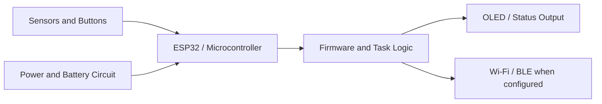

  

<h1 align="center">Prasanna Pojgey</h1>

  <strong>Embedded Systems · IoT · Firmware · Robotics</strong> 
  Building practical systems with microcontrollers, sensors, and software.

  
  

## About

I work on embedded firmware, connected devices, and hands-on engineering projects. My current focus includes ESP32 development, FreeRTOS concepts, hardware interfaces, Linux, and practical project documentation.

- **Embedded:** ESP32-C3, Arduino framework, PlatformIO
- **Firmware:** C/C++, task-based design concepts, debugging, OTA update concepts
- **Interfaces:** I2C, UART, GPIO, sensors, OLED displays
- **Systems:** Linux, Git, hardware bring-up and troubleshooting
- **Exploring:** Robotics and computer vision

## Technical Stack

  
  
  
  
  
  
  
  

## Featured Projects

<table>
  <tr>
    <td width="50%">
      <h3><a href="https://github.com/pojge2005/SmartKeychain-V2">SmartKeychain V2</a></h3>
      
ESP32-C3 device project with an OLED interface, physical-button navigation, and PlatformIO build setup.

      
ESP32-C3 · C++ · PlatformIO · SSD1306

    </td>
    <td width="50%">
      <h3><a href="https://github.com/pojge2005/ESP32-FreeRTOS-IoT">ESP32 FreeRTOS IoT</a></h3>
      
Embedded learning project focused on ESP32, real-time firmware concepts, and IoT development.

      
ESP32 · FreeRTOS · IoT

    </td>
  </tr>
  <tr>
    <td width="50%">
      <h3><a href="https://github.com/pojge2005/Two-Layer-RFID-Security-System">Two-Layer RFID Security</a></h3>
      
RFID-based access-control project. See the repository for implementation and hardware details.

      
RFID · Embedded Systems · Security

    </td>
    <td width="50%">
      <h3><a href="https://github.com/pojge2005/Real-Time-Object-Tracking-System-Raspberry-Pi-OpenCV-">Real-Time Object Tracking</a></h3>
      
Computer-vision project exploring object tracking with Raspberry Pi and OpenCV.

      
Raspberry Pi · Python · OpenCV

    </td>
  </tr>
  <tr>
    <td width="50%">
      <h3><a href="https://github.com/pojge2005/Implement-OTA-Firmware-Updates-on-ESP32">ESP32 OTA Firmware Updates</a></h3>
      
Project focused on over-the-air firmware update concepts for ESP32-based devices.

      
ESP32 · Firmware · OTA

    </td>
    <td width="50%">
      <h3><a href="https://github.com/pojge2005/Pofolio">Portfolio Website</a></h3>
      
Personal portfolio website built with HTML, CSS, and JavaScript.

      
HTML · CSS · JavaScript

    </td>
  </tr>
</table>

## Embedded System Overview

## GitHub Activity

  
  

  

These cards use third-party services and may be delayed or unavailable. Language and activity summaries are estimates, not skill ratings.

## Engineering Principles

- Document hardware, wiring, setup, limitations, and test results.
- Keep secrets and private configuration out of public repositories.
- Verify features on real hardware before marking them as tested.
- Prefer readable code, reproducible builds, and focused commits.

## Connect

  
  

---

Learning, building, testing, and documenting one engineering project at a time.

